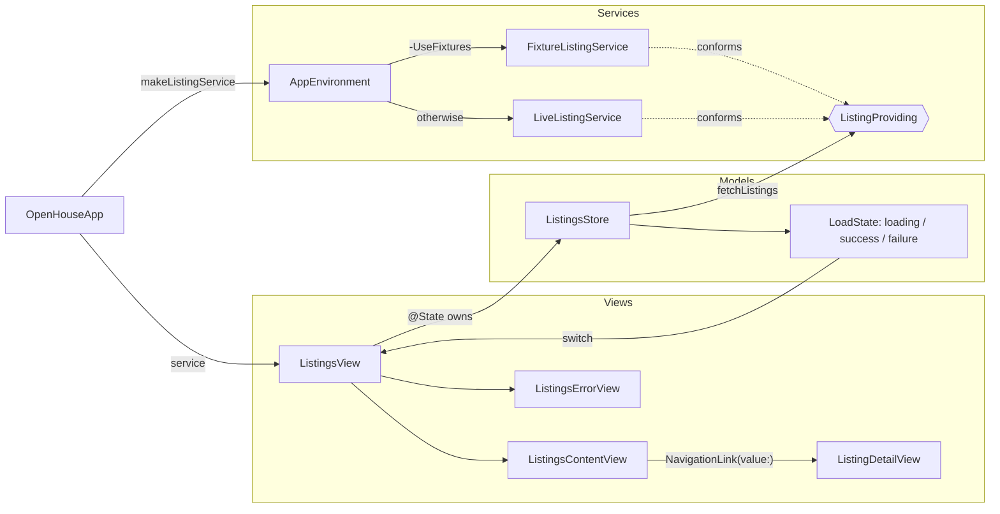

> [!NOTE]
> This repo is not a production app. It is an interview exercise for Swift engineer candidates, in the form of a PR: https://github.com/nicohaemhouts/SwiftCandidatePRExercise/pull/1

# OpenHouse

A small SwiftUI app that fetches property listings as JSON and shows them in a list with a detail screen.

## Running

Open `OpenHouse.xcodeproj` and run the `OpenHouse` scheme. The scheme passes `-UseFixtures`, which serves the bundled `listings.json` instead of calling the live API.

## Architecture

One `ListingsStore` per screen, created by the view that shows it. The store only talks to `ListingProviding`, so tests swap in a stub and the app swaps in fixtures with a launch argument. Content views receive plain values and never see the store.

## Structure

- `Models/` – value types decoded from the API, plus the `ListingsStore` that owns the loaded data and its `LoadState`.
- `Services/` – `ListingProviding` and its live and fixture implementations. Views never call the network directly.
- `Views/` – `ListingsView` switches over the store's state (skeleton / content / error) and the content views are pure rendering.
- `OpenHouseTests/` – Swift Testing suite for the store, using stubbed services.
# OpenHouse

A small SwiftUI app that fetches property listings as JSON and shows them in a list with a detail screen.

## Running

Open `OpenHouse.xcodeproj` and run the `OpenHouse` scheme. The scheme passes `-UseFixtures`, which serves the bundled `listings.json` instead of calling the live API.

## Structure

- `Models/` – value types decoded from the API, plus the `ListingsStore` that owns the loaded data and its `LoadState`.
- `Services/` – `ListingProviding` and its live and fixture implementations. Views never call the network directly.
- `Views/` – `ListingsView` switches over the store's state (skeleton / content / error) and the content views are pure rendering.
- `OpenHouseTests/` – Swift Testing suite for the store, using stubbed services.
